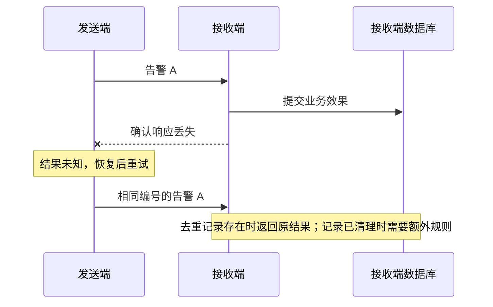

# 确认丢失下的告警去重研究

### 固定请求截止时间与事务性去重的设计、验证及保证边界

| 项目 | 说明 |
|---|---|
| 课程切入点 | 实时告警的交付语义、幂等键与状态 TTL |
| 研究对象 | 接收端已经处理，但发送端未获得或未保存确认的告警 |
| 实验日期 | 主实验：2026年11月17日；补充实验与复核：2026年11月18日 |
| 实验环境 | Windows、Node.js v24.22.1、内置 SQLite |
| 材料 | [完整 AI 协作对话](完整对话记录.md) · [代码与原始数据](experiment-full.zip) |

> **核心结论：**唯一编号只能帮助识别请求，不能单独消除重复业务效果。事务性去重在记录有效期间可以处理本实验覆盖的重复与崩溃，但记录清理后的迟到请求仍可能再次生效。固定截止时间与接收端过期拒绝能够阻止这条路径，同时会拒绝过晚到达、此前从未成功处理的任务。

---

## 摘要

实时告警可能出现接收端已提交业务操作、发送端却没有得到成功确认的情况。此时，重新发送可能导致重复业务效果，而放弃重试可能遗漏尚未完成的任务。本文以海区拥挤告警为背景，从课程中的“告警带幂等键，发过的键不再发”出发，研究确认丢失后去重机制的保证边界。通过阅读官方文档和原始论文，本文将问题进一步聚焦到去重记录清理后的迟到重试，并提出由持久化任务、事务性去重、固定请求截止时间、接收端过期拒绝及结果核查组成的方案。

实验包括22个确定性场景与组别组合、72批次共2880项任务、独立存储实验，以及将恢复时间和在途到达时间分开的48项补充场景和3项截止边界测试。主实验中，仅编号与重试、固定 TTL 事务去重、加入截止机制三组分别产生724、106、0次额外业务效果；第三组同时有88项任务未生效。补充实验支持同样的安全性与可用性取舍。上述结果只适用于本次受控故障模型和模拟接收端数据库，不构成真实短信端到端恰好一次的证明。

**关键词：**确认丢失；实时告警；幂等；事务；崩溃恢复；去重有效期

## 1. 研究背景与具体问题

### 1.1 与课程知识的联系

第5讲课时1第7页介绍可重放日志，第11页介绍有状态流处理与 TTL；课时2第9—11页介绍交付语义、检查点，以及源、算子和汇共同构成的端到端保证；课时3第7页用短信说明“开启检查点”并不足以避免外部重复效果，第13页提出杀进程复活演练。[6]

课程给出的修法是使用 `alert_id = 海区 + 窗口起点`，对已经发送的键不再发送。本文继续追问：**系统如何可靠地知道“已经发送”？这个判断记录保存多久？记录删除之后收到旧请求怎么办？**

业务背景沿用“海区B每10分钟船数超过60艘时产生拥挤告警”。为控制范围，本文从已经可靠生成的告警任务开始研究投递，不重新研究船数统计、水位线选择、迟到修订或阈值合理性。基础实验约定同一海区、窗口及规则版本只生成一项业务告警。

### 1.2 三种事件不能混为一谈

| 事件 | 本文定义 | 不代表什么 |
|---|---|---|
| 请求已发送 | 发送端记录一次发送尝试并将请求交给传输驱动 | 不代表接收端已经处理 |
| 业务已生效 | 接收端向通知业务表提交一条记录 | 不代表发送端已经知道结果 |
| 成功已确认 | 发送端收到提交证据并持久化成功状态 | 不代表真实手机已经收到或阅读短信 |

本文允许重复请求，主要检验是否重复产生业务效果。一个任务可以发送多次，但只生效一次。

### 1.3 故障反例

如果发送端先记“已发送”再调用接口，二者之间崩溃可能漏处理；如果先调用接口再记录成功，接口已成功而本地尚未记录时崩溃，恢复后的重试可能重复处理。因此，调整本地操作顺序并不能独自消除不确定性。



## 2. 文献与工程实践

本次采用针对具体问题的定向检索，优先使用官方文档与原始论文，检索日期为2026年11月17日。检索主题包括确认丢失、幂等请求、迟到重试、完成记录持久化及回收。这不是穷尽式系统综述，不能据此判断方案具有全球首创性。

| 来源 | 与本研究有关的事实 | 对方案的启示 |
|---|---|---|
| RabbitMQ 可靠性指南 [1] | 未确认消息可能需要重传，确认丢失会产生重复 | 接收端需要幂等处理；超时不能解释成未执行 |
| AWS Builders’ Library [2] | 分析请求标识、语义等价响应、迟到请求和参数冲突 | 同一任务重试时保持身份与意图不变 |
| Stripe API v1 [3] | 幂等键至少保存24小时后可清理，清理后复用会形成新请求 | 幂等保证存在生命周期边界，不能默认永久防重 |
| RIFL，SOSP 2015 [4] | 讨论请求识别、完成记录持久化、重试定位与垃圾回收 | 完成记录回收也是正确性问题 |
| AWS Transactional Outbox [5] | 在同一事务保存业务变更与待发送事件，下游仍需处理重复 | 持久化任务解决恢复入口，不能替代接收端去重 |

RIFL 是经典研究，不是最新成果；本文也未实现完整 RIFL。Stripe 的上述规则针对 API v1，不推广到所有服务或版本。

这些资料形成共同基础：**编号、持久化、原子性与生命周期需要共同设计。** 本文的工程探索是在告警场景中构造跨保留期限的反例，再评估一种明确限定执行时间的方案。

## 3. 研究问题、故障模型与指标

### 3.1 研究问题

- **RQ1：**确认丢失时，仅有唯一编号是否足够？
- **RQ2：**将完成记录与业务效果原子提交后，能否处理崩溃和并发重复？
- **RQ3：**去重记录按 TTL 清理后，迟到重试会怎样？
- **RQ4：**固定截止时间能否阻止清理后的旧请求再次执行，代价是什么？

### 3.2 假设与范围

允许进程崩溃恢复、请求不可达、确认丢失、请求延迟和并发重复。SQLite 正确实现事务、唯一约束及进程崩溃后的持久化恢复。磁盘永久损坏、断电测试、恶意调用、多地域分裂和真实短信服务不在本实验范围内。

接收端的“效果”是数据库业务表的一次插入。该表的 `id` 没有唯一约束，避免它暗中提供永久去重。用于核查的业务历史不参与接收端是否执行的判断，必须另外计算存储成本。

### 3.3 指标定义

设任务 i 实际生效次数为 eᵢ：

- **额外业务效果数：**Σ max(eᵢ−1, 0)。它不是重复任务数。
- **未生效任务数：**观察终点 eᵢ=0 的任务数。
- **结果未知数：**发送端尚未获得成功确认的任务数，需与实际生效情况交叉核对。
- **额外请求数：**首次发送之外的发送尝试数。
- **生效与确认延迟：**分别从任务开始计算，单位为实验逻辑秒。
- **存储量：**分别观察去重记录、待发送任务和业务核查记录，不能只统计其中一类。

对没有生效或确认的任务单独报告数量，不把它们静默排除后宣称系统更快。

## 4. 改进方案

### 4.1 稳定身份与固定截止时间

请求包含 `alert_id`、`payload`、`accept_until`（实现字段名为 `deadline`）及覆盖请求身份、内容、截止时间的签名。接收端另外保存内容哈希。重试、恢复和回放不得重新生成身份或延长期限。同一编号但不同内容或截止时间应拒绝。

实验使用固定公开 HMAC 密钥模拟可信签发，这不是生产安全方案。部署时需要独立的可信签发方与密钥管理。

### 4.2 持久化发送状态

| 状态 | 含义及后续处理 |
|---|---|
| `PENDING` | 任务已可靠保存，等待发送 |
| `IN_FLIGHT` | 已发送但结果不确定，重启后不能直接认定成功 |
| `CONFIRMED` | 已持久化接收端提交证据 |
| `EXPIRED_UNKNOWN` | 不再自动新增重试，但历史执行结果仍可能未知 |
| `REJECTED` | 参数冲突或格式问题等明确拒绝 |

业务任务与 outbox 在同一事务中创建，数据库触发器阻止任务身份被修改。到期停止新增重试后，已在途的请求仍可能到达，因此还需要接收端执行过期判断。收到过期拒绝不证明之前没有成功处理。

### 4.3 接收端事务

接收端取得写锁后，依次执行：

1. 校验请求格式与签名。
2. 若有完成记录，检查内容和截止时间是否一致；一致则返回原提交结果，冲突则拒绝。
3. 若没有完成记录且已到截止时间，拒绝产生新效果。
4. 否则，在同一事务写入业务效果和完成记录。
5. 提交成功后才返回确认。

实际代码在进入事务前做格式与签名校验，进入事务并取得锁后读取时间、检查完成记录和截止时间。业务写入和完成记录不会分成两次提交。SQLite 的 `BEGIN IMMEDIATE` 将处理与清理操作串行化，避免“先查不存在、并发各写一条”的竞态。

### 4.4 去重回收规则

设首次执行时刻为 t₀，配置 TTL 为 L，截止时间为 D。B 组在 t₀+L 后允许清理；C 组在 **max(t₀+L, D)** 后允许清理。截止语义为：没有完成记录时，接收端时间 **t≥D** 就拒绝首次执行。

这两条规则缺一不可：只停止发送不能消除在途请求；只在接收端拒绝过期请求，但在有效期内提前删除记录，仍可能对有效的重复请求再次执行。

时间检查发生在取得事务写锁之后，清理也使用相同写锁。本文以锁内时间判定是否准入；已经准入的事务可以稍后提交，并不承诺所有业务提交必须发生在物理截止时刻之前。

C 组还持久化已见时间的高水位，使用 max(旧高水位, 当前时间)，防止清理后时钟回拨重新打开执行期限。该方法的代价是一次异常前跳可能使后续请求过早失效。实验明确展示此代价，而不是将时钟问题视为完全解决。

### 4.5 超期核查

对结果未知的任务，可以按编号查询仍保留的业务历史。查到提交证据后补记确认；查不到时继续保持未知。不能因查不到而自动更换编号补发，否则可能绕过去重。

核查改善的是发送端对结果的认识，不会把未执行任务变成已执行任务。它依赖额外保留的审计证据，不能无成本地无限期追溯。

## 5. 实现与实验组织

### 5.1 运行环境

代码采用 Node.js v24.22.1 内置 `node:sqlite`，无第三方运行依赖。SQLite 使用 WAL、`synchronous=FULL`、10秒 busy timeout 和 `BEGIN IMMEDIATE`。发送端、接收端可以独立运行，故障驱动通过本地文件传递消息并控制提交前后屏障。

强杀测试由操作系统结束真实子进程，并检查终止请求、退出状态及错误输出；恢复后读取实际数据库。并发测试启动6个进程争用写锁。请求延迟通过逻辑时钟和驱动调度实现，不是实测 HTTP 网络延迟。

### 5.2 对照方案

| 组别 | 方案 |
|---|---|
| A | 固定编号、持久化任务和重试，无接收端去重 |
| B | A 加事务性去重，按固定 TTL 清理完成记录 |
| C | B 加固定截止时间、到期停止新增重试、接收端过期拒绝、延长必要保留期及核查 |

三组使用相同业务输入和规范化请求，均做签名校验。原始实验与补充实验分别保存，不将不同工作负载直接混成一个总体发生率。

### 5.3 实际完成的研究流程

| 阶段 | 实际工作及产物 |
|---|---|
| 选题与检索 | 从课程告警例子收敛到确认丢失，核对5项外部来源 |
| 实现 | 持久化状态、原子去重、截止与清理协同、核查接口 |
| 确定性验证 | 22个故障场景与组别组合，含进程强杀和并发 |
| 主批量实验 | 72批次、2880任务，保留数据库与逐任务记录 |
| 存储实验 | 4种配置，每配置连续200项任务 |
| 补充实验 | 48项恢复/到达时间分离场景，3项截止边界测试 |
| 复核 | 行为测试、数据库逐项对账、失败原因与修订记录 |

这些是已完成工作。持续运行的退避调度器、后台扫描服务、负载压测和真实短信集成未实现，不作为本报告的已完成成果。

## 6. 实验结果

### 6.1 确定性故障实验

共22个“场景×组别”组合通过预设断言。“通过”包括成功复现不可靠方案的失败行为，并不表示每组均可靠。

| 编号 | 注入条件 | 观测结果 |
|---|---|---|
| F00 | 业务生成后、outbox写入前强杀 | 业务记录和outbox一起回滚，均为0行 |
| F01 | 接收端提交前强杀 | 三组崩溃后均无效果，重试后均1次 |
| F02 | 接收端提交后、返回确认前强杀 | A为2次效果，B/C为1次 |
| F03 | 发送端收到确认、保存前强杀 | 恢复为IN_FLIGHT；A为2次，B/C为1次 |
| F04 | 6个接收进程并发处理同一编号 | A为6次效果，B/C为1次 |
| F05 | 去重清理后旧请求到达 | A/B为2次效果，C为1次且过期拒绝 |
| F06 | 首次请求到达时已经过期 | A/B为1次，C为0次 |
| F07 | 同编号改变内容或未重新签名地改变截止时间 | C分别返回冲突和非法请求 |
| F08 | 事务持有写锁，清理和重复请求并发等待 | 该次交错下C只有1次效果 |
| F09 | 清理重启后时间回拨，以及异常前跳 | C不重执行旧请求，但前跳后新任务也可能被拒绝 |

F05 是受控调用序列中的迟到投递反例，发送时刻是驱动的情景设定，并非真实网络捕获；主批量与补充实验另外保存了在途请求的发送端记录。F08覆盖一次具体真实锁竞争，不能据此证明所有并发交错。

### 6.2 主批量实验配置

固定种子为17、29、43；首次确认丢失概率为0.25/0.75；恢复与在途延迟参数为5/120逻辑秒；TTL为10/150秒；每配置40任务。3×2×2×2×3=72批次，共2880任务，每组960项。任务有效期为100秒，首次不可达按0.2概率采样。

每个任务使用独立时间区间，避免全局时钟倒退。长延迟情况下，在结果未知时于第1秒发出并持久化一个在途请求，恢复时尝试新增重试，随后交付在途请求。恢复后的确认可达；C超期后查询仍保留的业务记录。该调度是有限事件序列，不代表无限期重试服务。

同一种子在不同组和参数间复用，用于配对比较。因此，2880项不能当作独立同分布样本，也不据此给出生产故障率的置信区间。

### 6.3 主实验总体结果

| 指标 | A | B | C |
|---|---:|---:|---:|
| 任务数 | 960 | 960 | 960 |
| 额外业务效果数 | 724 | 106 | 0 |
| 未生效任务数 | 0 | 0 | 88 |
| 核查后仍未知的任务数 | 0 | 0 | 88 |
| 首次以外发送请求数 | 900 | 900 | 600 |

C的未生效比例为88/960≈9.17%。这是特定合成工作负载下的观察，不是实际告警漏发率。A/B在观察终点全部生效也不表示它们在持续故障下保证不漏。

### 6.4 分参数结果

以下每行每组240项任务，汇总两个确认丢失参数和三个种子。

| delay | TTL | A额外效果 | B额外效果 | C额外效果 | C未生效 |
|---:|---:|---:|---:|---:|---:|
| 5 | 10 | 106 | 0 | 0 | 0 |
| 5 | 150 | 106 | 0 | 0 | 0 |
| 120 | 10 | 256 | 106 | 0 | 44 |
| 120 | 150 | 256 | 0 | 0 | 44 |

长TTL的B也没有重复，因为保留时间覆盖了本次迟到范围。C不是对B的全面改进：它通过明确拒绝过期执行获得更清楚的边界，却放弃了过晚任务的自动完成机会。

长延迟的两个TTL切片中，C核查前共300项结果未知，核查后剩88项；其中212项已生效任务通过业务记录得到确认。核查没有补执行剩余88项。

### 6.5 生效与确认延迟

2026年11月18日从原始逐任务数据补算P95，采用排序后的 nearest-rank 定义，保留两位小数。单位为逻辑秒，不是系统性能基准。

| 方案 | 有生效记录样本数 | 生效延迟P95 | 已确认样本数 | 确认延迟P95 | 未生效/未确认数 |
|---|---:|---:|---:|---:|---:|
| A | 960 | 120.26 | 960 | 120.77 | 0 |
| B | 960 | 120.26 | 960 | 120.77 | 0 |
| C | 872 | 5.34 | 872 | 122.71 | 88 |

C的生效P95较低，部分原因是88项过晚任务根本没有生效，不可据此宣称C更快。其确认P95较高，是因为部分任务需要等到超期后的核查；安全拒绝、业务生效和结果获知是不同目标。

### 6.6 补充实验：分离恢复时间与到达时间

原主实验的delay同时控制服务恢复和在途到达，两者存在混杂。因此新增独立组合：恢复时间5/120秒、在途到达20/130秒、TTL 10/150秒、首次已生效/未生效、A/B/C三组，共48个确定性场景，每组16项。

首次已生效场景故意丢弃确认。在第1秒由发送端持久化在途请求，之后按时间顺序执行恢复、到达、过期扫描，接收响应后更新发送端状态。必要时在第150秒核查。每项保存完整事件轨迹及双方数据库。

| 方案 | 场景数 | 额外业务效果数 | 未生效任务数 |
|---|---:|---:|---:|
| A | 16 | 20 | 0 |
| B | 16 | 8 | 0 |
| C | 16 | 0 | 2 |

C的两个未生效场景均为首次未成功、恢复与在途到达都超过截止时间，分别对应两种TTL。若恢复较晚但在途请求及时到达，C仍可完成；若恢复及时但在途请求过晚，C可通过恢复重试完成并拒绝后续旧请求。因此，不能单看恢复时长推断是否漏处理。

另对无完成记录的新请求分别在99、100、101秒到达进行测试：99秒生效，100和101秒过期拒绝，确认实现采用半开有效区间 t<D。

### 6.7 独立存储实验

按每逻辑秒一条连续生成200任务，期限为生成后100秒，每秒先清理再接收。

| 方案 | TTL | 峰值去重行数 | 保留业务记录数 | 第400秒去重行数 |
|---|---:|---:|---:|---:|
| B | 10 | 10 | 200 | 0 |
| B | 150 | 150 | 200 | 0 |
| C | 10 | 100 | 200 | 0 |
| C | 150 | 150 | 200 | 0 |

C在TTL=10时仍需要覆盖100秒有效期，故去重峰值为100行，明显高于B的10行。业务核查记录没有被清理，四种配置均保留200行，不能声称整体存储有界。行数不是数据库物理字节，文件分配、索引和审计保留期另有成本。

## 7. 正确性分析、创新点与限制

### 7.1 为什么该机制能阻止本研究中的重复路径

若请求尚未过期，首次已提交时其完成记录不得清理；写锁和唯一约束使相同请求只能复用结果。若请求已经过期，记录尚存则返回原结果，记录已删除则拒绝新增效果。业务与完成记录原子提交，排除了仅写其中一项的崩溃窗口。

上述推导依赖身份和截止时间不变、持久化可靠、事务与清理协调以及接收端时间策略成立。它是针对本实现模型的条件分析，不是对任意分布式系统的形式化证明。

### 7.2 课程原创探索

本文不把幂等、事务或outbox作为新发明。可归属本项目的探索包括：构造跨去重保留期限的告警反例；把截止时间、接收端准入和去重回收联动；设计崩溃、并发、过期和时钟异常实验；将恢复与到达时间拆分验证；同时报告重复效果、未生效、未知结果及存储代价。

### 7.3 保证到哪里

| 目标 | 本文能支持的结论 |
|---|---|
| 不重复业务效果 | 在列明假设和覆盖场景内，C没有观察到重复 |
| 最终一定生效 | 不保证；长期故障跨越截止时间时可能被拒绝 |
| 发送端最终知道结果 | 还依赖确认或核查证据可达且仍保留 |
| 存储始终有界 | 不保证；业务审计记录在本实验中继续保留 |
| 手机只收到一次短信 | 未验证；真实短信接口在本地事务之外 |
| 生产延迟和吞吐 | 未测试；逻辑秒不代表真实服务性能 |

真实业务需要决定“过晚告警是否仍值得发送”。延长期限可能减少未完成任务，却增加存储和过时通知风险。本文的100秒只用于实验，不能直接作为生产推荐值。

## 8. 复核、可复现性与AI协作

### 8.1 发现的问题与修复

初轮实验把在途请求计入汇总，但没有同时计入发送端outbox。独立核验得到发送次数2与汇总3不一致。修复为第1秒实际调用发送端接口、持久化计数，再保存不可变请求等待交付。初轮目录`runs/main`留作失败研究记录，正式结论使用`runs/verified`。

独立代码审查还指出强杀实验应核验终止结果。实现增加了终止请求返回值、退出信号或非零状态及无超时错误输出检查。补充研究则纠正了恢复与到达参数混杂的问题，并增加延迟统计时的未完成样本说明。

### 8.2 验证证据

6项行为回归测试通过；22项确定性组合完成；独立脚本从72对主实验数据库逐项核对2880条任务的效果数、请求次数和最终状态。补充的48对数据库、3个截止边界数据库及4个存储数据库也完成核对。结果、日志和源文件校验值保存在实验包中。

这些核验避免只相信驱动程序自身汇总，但不能替代对未覆盖故障的分析。

### 8.3 复现步骤

解压`experiment-full.zip`后，在`alert-lab`目录使用Node.js 24执行：

```powershell
node --test test.mjs
node audit-all.mjs
node experiment.mjs runs/reproduction
node verify.mjs runs/reproduction
node supplement.mjs runs/supplement-reproduction
node storage.mjs runs/storage-reproduction
```

`audit-all.mjs`核查包内已保存的正式结果；其余命令生成新的运行目录，避免覆盖原始数据。若重新核对新生成的补充或存储目录，可按脚本中对应路径调整。环境、随机种子和事件调度说明见包内README。

### 8.4 AI协作记录

AI参与选题讨论、文献整理、方案推导、代码实现、故障注入和报告整合，用户提出研究范围与提交要求。原始用户文字消息、AI过程更新与最终回复按时间导出到同目录`完整对话记录.md`，保留先前方案的不完善、实验失败及后续修正，不用整理摘要代替。导出为固定时点快照，范围和附件情况在文件开头声明。

## 9. 结论

唯一编号不足以避免确认丢失后的重复业务效果。事务性去重能够处理本实验覆盖的记录保留期内重复，但在固定TTL清理后仍可能重新执行旧请求。固定请求截止时间、接收端过期拒绝及去重保留规则共同形成了更明确的执行边界。

主实验及补充实验均未在C组观察到重复效果，同时观察到过期未生效任务和更高的必要去重保留量。因此，可信的改进是明确并验证保证条件与代价，而不是宣称消除了所有重复和漏发。对实时告警，应同时定义业务有效期、允许的恢复范围、完成记录保留策略及结果未知时的核查方式。

## 参考文献

[1] RabbitMQ. *Reliability Guide*. https://www.rabbitmq.com/docs/reliability （访问：2026-11-17）。

[2] Featonby, M. *Making retries safe with idempotent APIs*. Amazon Builders’ Library. https://aws.amazon.com/builders-library/making-retries-safe-with-idempotent-APIs/ （访问：2026-11-17）。

[3] Stripe. *Idempotent requests*. https://docs.stripe.com/api/idempotent_requests （访问：2026-11-17；保留期说明针对API v1）。

[4] Lee, C., Park, S. J., Kejriwal, A., Matsushita, S., & Ousterhout, J. *Implementing Linearizability at Large Scale and Low Latency*. SOSP, 2015. DOI: 10.1145/2815400.2815416. https://sigops.org/s/conferences/sosp/2015/current/2015-Monterey/printable/126-lee.pdf 。

[5] AWS Prescriptive Guidance. *Transactional outbox pattern*. https://docs.aws.amazon.com/prescriptive-guidance/latest/cloud-design-patterns/transactional-outbox.html （访问：2026-11-17）。

[6] 用户提供的课程资料：第5讲课时1《凌晨三点的船流高峰》、课时2《什么时候敢说记完了》、课时3《AI写的实时告警能直接上线吗》。相关页码见第1节。

---

## GitHub访问链接

**公开仓库：[19883557981-design/alert-deduplication-study](https://github.com/19883557981-design/alert-deduplication-study)**

仓库提交材料为`README.md`、本实验报告、`完整对话记录.md`与`experiment-full.zip`。本地整理完成不等于远端上传成功，远端文件以实际提交为准。
